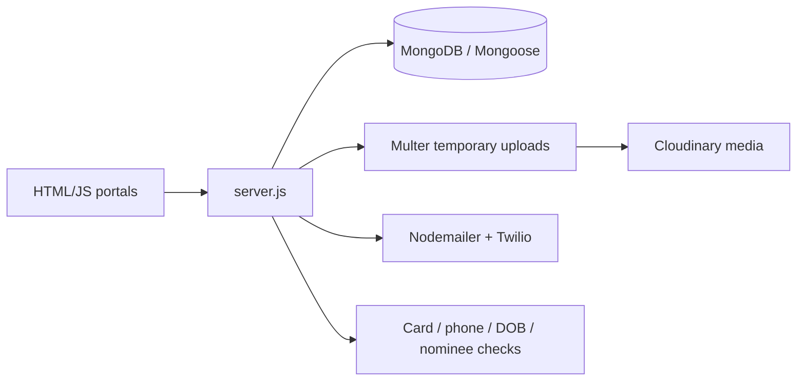

# Gram-Verify

Gram-Verify is a Node.js/Express portal prototype for rural identity and banking workflows. It combines registration and login, document/photo uploads, user and bank dashboards, nominee verification, administrator flows, and notification integrations.

## Architecture



`server.js` is the backend entrypoint and currently contains the route wiring, persistence models, upload handling, provider configuration, and verification flows. The many HTML pages represent separate user, bank, administrator, nominee, and face/document screens.

## Main workflows and routes

- Public pages: `/`, `/login`, and `/register`
- Account creation: `POST /register` with profile and document fields
- Authentication: `POST /login`
- User views: `/dashboard`, `/banking`, `/api/userinfo`, and `/api/bankinfo`
- Bank updates: `POST /api/updatebank` and `POST /api/updatebankandnominee`
- Administrator flow: `/admin/login`, `/admin/dashboard`
- Verification steps: `/login/verify/cardNo`, `/login/verify/phone`, `/login/verify/dob`, and `/api/verify-nominee`
- Nominee data: `GET /api/nominees`

These endpoints reflect the current prototype implementation and are not a stable public API. Review validation, session behavior, and authorization in `server.js` before exposing them.

## Local setup

Requirements: Node.js/npm, MongoDB, and provider accounts/configuration for Cloudinary, email, and SMS where those features are enabled.

```bash
npm ci
npm start
```

Configure MongoDB, mail, Twilio, Cloudinary, session, and application secrets using the deployment secret manager. Keep provider credentials out of source control and browser-delivered files. The application writes temporary upload files under `uploads/`; use a managed temporary volume and cleanup policy in deployment.

## Project layout

| Path | Responsibility |
| --- | --- |
| `server.js` | Express routes, models, verification, uploads, notifications |
| `login.html` / `register.html` | Authentication and registration screens |
| `dashboard1.html` / `banking.html` | User and banking views |
| `admin*.html` | Administrative workflow screens |
| `nominy.html` | Nominee workflow |
| `face*.html` and `script*.js` | Client-side verification behavior |
| `uploads/` | Local upload staging area; do not treat it as durable storage |

## Deployment and operations

Run behind HTTPS with managed MongoDB and private media configuration. Enforce server-side role authorization for every administrator/bank route, use signed or expiring media URLs, restrict upload MIME types and sizes, delete temporary files after transfer, and define retention/deletion procedures for identity documents.

## Testing and limitations

`npm test` is a placeholder and exits without running tests. Before handling real identity information, add route, authorization, upload, notification, and provider-failure tests. Manually test duplicate accounts, failed verification, malformed files, provider outages, session expiry, and privilege-escalation attempts. This prototype should not be treated as a production identity-verification or banking system without an independent security and compliance review.

## Security

Identity documents, photos, phone numbers, and banking information are highly sensitive. Do not commit credentials, tokens, uploaded documents, or personal data. Rotate any credential exposed in repository history, minimize logs, and restrict database/media access.

## License

See the repository license file and package metadata for the authoritative terms.
