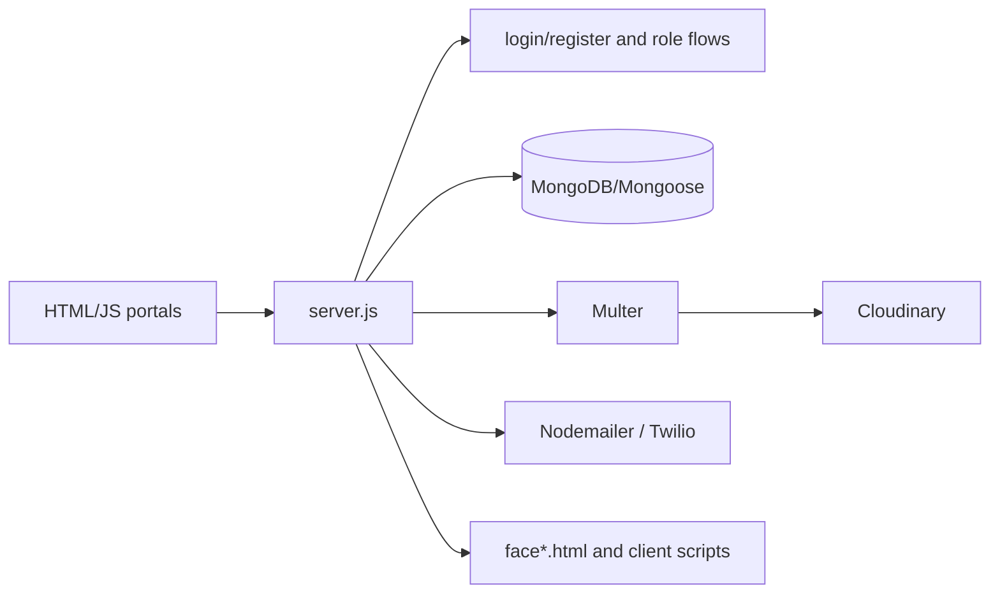

# Gram-Verify

A Node.js/Express verification portal with separate user, administrator, bank, document, dashboard, and face-verification pages. It uses MongoDB/Mongoose, Multer uploads, Cloudinary media, email, and Twilio integrations.

## Architecture



`server.js` is the backend entrypoint. The many HTML/JS pages represent user and administrator workflows; `script*.js`, `dashboard*.js`, and `face*.js` contain browser behavior.

## Setup

```bash
npm ci
# configure MongoDB, Cloudinary, mail, Twilio, and application secrets locally
npm start
```

The service expects Node.js with the dependencies in `package.json`; keep all provider credentials in environment variables.

## Workflow and data

Users register/login, submit identity or document data, and interact with verification dashboards. Express validates and persists records, Multer handles uploads, Cloudinary stores media, and notification providers deliver status messages. Review `server.js` for the current route contract before integrating clients.

## Deployment

Run behind HTTPS with a managed MongoDB and private media configuration. Enforce role-based authorization server-side, use signed/expiring media URLs, and configure strict upload limits and retention/deletion policies.

## Testing and limitations

`npm test` is a placeholder. Add automated route and authorization tests before handling real identity documents; manually test failed uploads, duplicate accounts, privilege escalation attempts, provider outages, and face-verification edge cases.

## Security and operations

- Keep credentials, database URLs, OAuth tokens, API keys, and signing secrets in environment variables; never commit them.
- Validate and constrain uploaded files and user input at the server boundary, and enable HTTPS in production.
- Review dependency updates and rotate any credential that has appeared in repository history.

## Testing

The repository currently has no comprehensive automated test suite unless noted above. Before production changes, add tests for authentication/authorization, validation failures, persistence errors, and the primary user workflow.

## Limitations and roadmap

This is an actively evolving project. Production hardening, observability, rate limiting, backup/retention policy, and accessibility/performance validation should be completed before handling sensitive or high-volume workloads.

## License

See the repository license file and package metadata for the authoritative terms.
